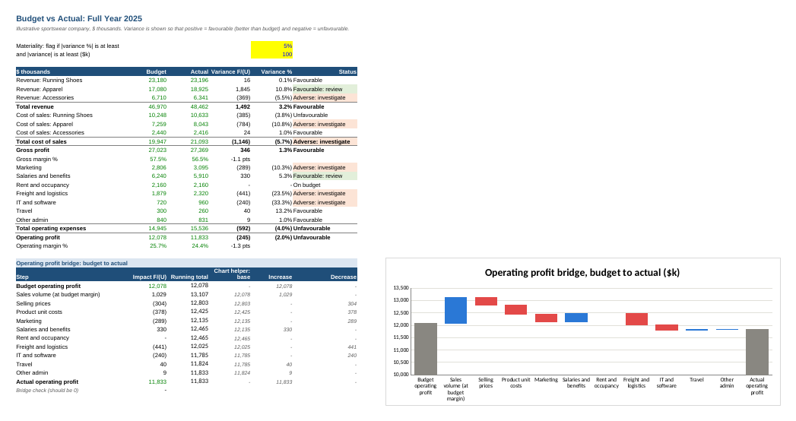
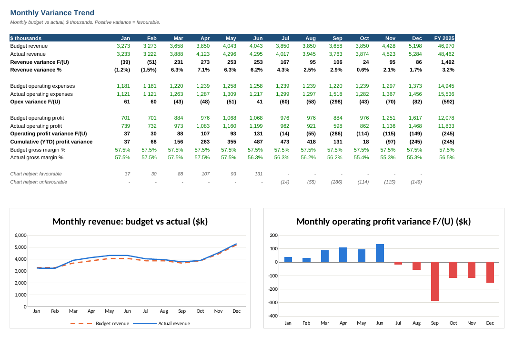
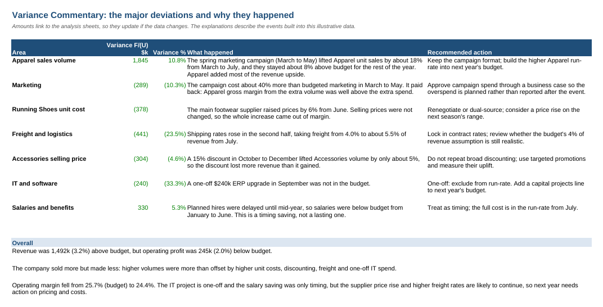
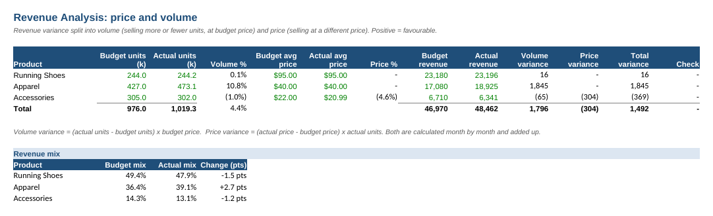
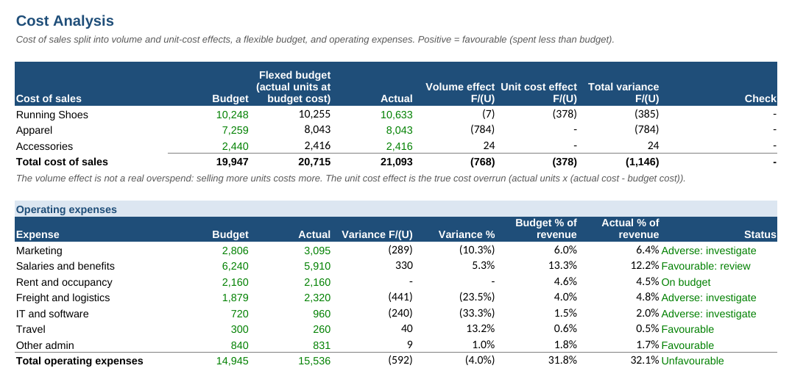

# Budget vs Actual Analysis

A full-year budget vs actual review for an illustrative sportswear company. It covers revenue, expense, profit and percentage variances, splits them into price, volume and cost effects, and explains the major deviations. Built in Excel, with every variance as a live formula.

**Downloads:** [⬇ Excel workbook](https://github.com/MuhammedAnshajK/budget-vs-actual-analysis/raw/main/budget_vs_actual_2025.xlsx) · [⬇ PDF version](https://github.com/MuhammedAnshajK/budget-vs-actual-analysis/raw/main/budget_vs_actual_2025.pdf) · [⬇ Budget data (CSV)](https://github.com/MuhammedAnshajK/budget-vs-actual-analysis/raw/main/data/budget.csv) · [⬇ Actual data (CSV)](https://github.com/MuhammedAnshajK/budget-vs-actual-analysis/raw/main/data/actual.csv) · [⬇ Python script](https://github.com/MuhammedAnshajK/budget-vs-actual-analysis/raw/main/build_analysis.py)

## Headline: sold more, made less

| $ thousands | Budget | Actual | Variance F/(U) | % |
|---|---:|---:|---:|---:|
| Revenue | 46,970 | 48,462 | 1,492 | 3.2% |
| Cost of sales | 19,947 | 21,093 | (1,146) | (5.7%) |
| Gross profit | 27,023 | 27,369 | 346 | 1.3% |
| Operating expenses | 14,945 | 15,536 | (592) | (4.0%) |
| **Operating profit** | **12,078** | **11,833** | **(245)** | **(2.0%)** |

Revenue beat budget by 3.2%, but operating profit missed by 2.0%, and operating margin fell from 25.7% to 24.4%. The year started ahead of budget ($487k ahead after June) and then fell behind in the second half.

## Why profit missed budget

The operating profit bridge explains the whole $245k shortfall:

| Driver | Impact $k | What happened |
|---|---:|---|
| Sales volume | +1,029 | A spring marketing campaign lifted Apparel volume about 11% above budget for the year. |
| Salaries | +330 | Hiring was delayed until mid-year. This is a timing saving, not a lasting one. |
| Freight | (441) | Shipping rates rose in the second half, taking freight from 4.0% to about 5.5% of revenue. |
| Product unit costs | (378) | The footwear supplier raised prices by 6% from June, and selling prices were not changed. |
| Selling prices | (304) | A 15% Accessories discount in Q4 lifted volume by only about 5%. |
| Marketing | (289) | The campaign overspend. It paid back, because the extra Apparel volume added about $1.1m of gross margin. |
| IT and software | (240) | A one-off ERP upgrade that was not in the budget. |
| Other (travel, admin) | +48 | Small savings. |

## Approach

1. **Budget and actual P&Ls.** Monthly units, selling prices and unit costs for three product lines, plus seven expense lines. Revenue and cost of sales are calculated as units x price and units x cost.
2. **Sign convention.** Every variance is shown as favourable (positive) or unfavourable (negative): more revenue or less cost than budget is favourable.
3. **Materiality.** A line is flagged *Adverse: investigate* or *Favourable: review* when its variance is at least 5% **and** at least $100k. Both thresholds can be edited in yellow cells.
4. **Revenue variance** is split into **volume** ((actual units - budget units) x budget price) and **price** ((actual price - budget price) x actual units), month by month.
5. **Cost of sales** is compared with a **flexible budget** (actual units at budget unit cost). This separates the extra cost that simply comes from selling more (the volume effect) from a genuine cost overrun (the unit cost effect).
6. **Operating profit bridge** walks from budget profit to actual profit through volume (at budget margin), price, unit cost and each expense line, shown as a waterfall chart.
7. **Monthly trend** shows each month's variance and the year-to-date profit variance.
8. **Commentary** explains each major deviation with a recommended action. Amounts link to the analysis, so they update if the data changes.
9. **Checks** confirm that totals agree to the data, price + volume = the revenue variance, the bridge adds up, and the months add up to the year.

## Screenshots

| Commentary | Revenue analysis (price and volume) |
|---|---|
|  |  |

| Cost analysis (flexible budget) |
|---|
|  |

## How to use

1. Download `budget_vs_actual_2025.xlsx` and start with **Summary** and **Commentary**.
2. Change any blue input on the **Budget** or **Actual** sheets (for example, a month's units or a unit cost), and every variance, chart and comment amount updates.
3. Change the materiality thresholds (yellow cells on **Summary**) to see which lines get flagged.
4. Check that the **Checks** sheet still says **OK**.

To regenerate from scratch, run `python generate_data.py` and then `python build_analysis.py`.

## Data

The data is illustrative, and `generate_data.py` creates it with a fixed random seed. Real company budgets are confidential, so I built events into the actuals that a finance team would typically need to explain: a campaign, a supplier price rise, discounting, freight inflation, hiring delays and a one-off project.

## Files

- `budget_vs_actual_2025.xlsx`: the analysis workbook (Cover, Summary, Commentary, Revenue Analysis, Cost Analysis, Monthly, Budget, Actual, Checks)
- `budget_vs_actual_2025.pdf`: print-ready PDF of every sheet
- `data/budget.csv`, `data/actual.csv`: monthly inputs
- `generate_data.py`: creates the data
- `build_analysis.py`: builds the workbook (openpyxl)
- `images/`: screenshots

## Tools

Excel, Python (openpyxl), variance analysis, FP&A
